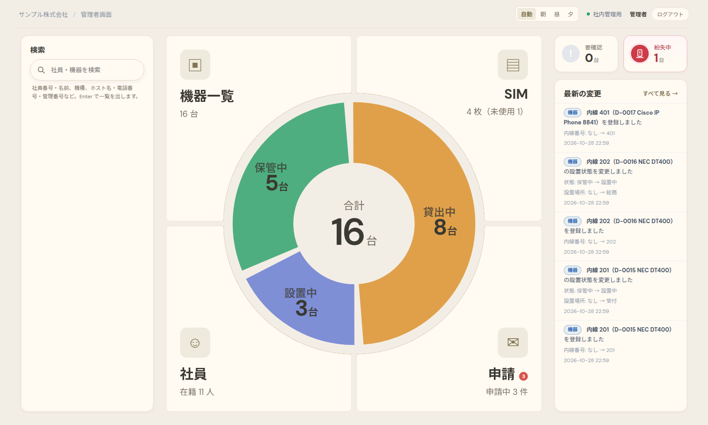
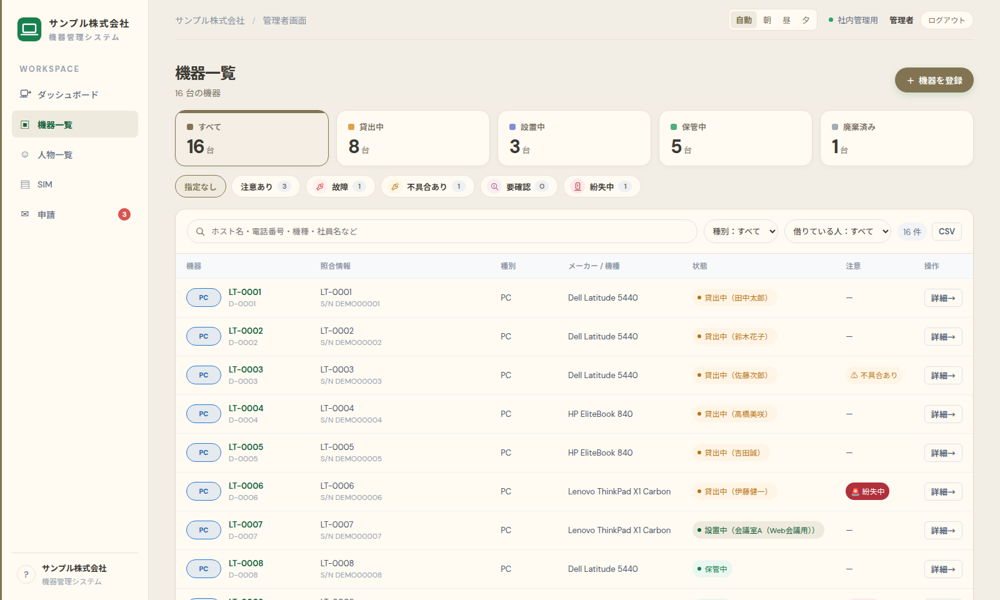
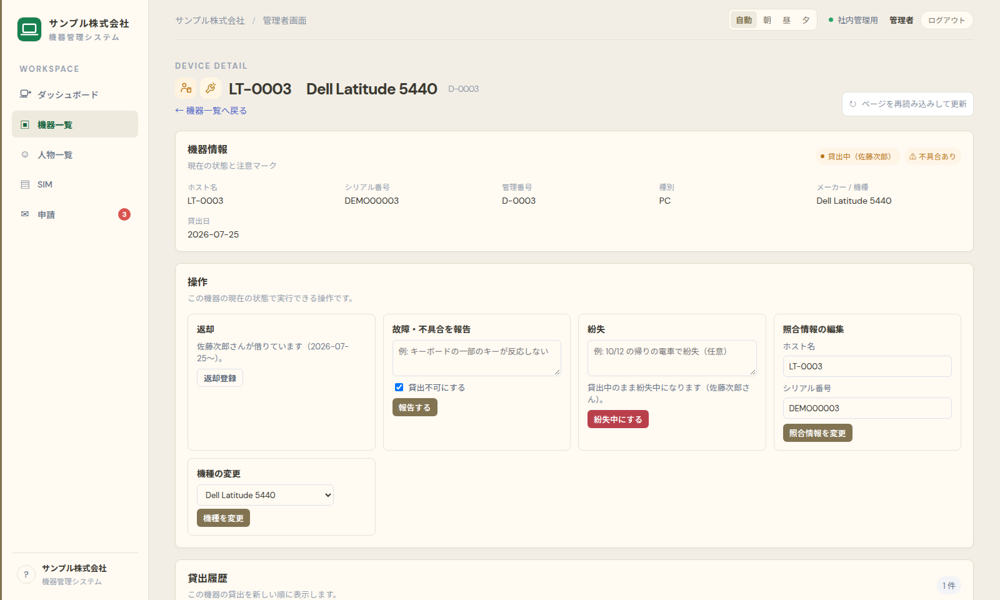
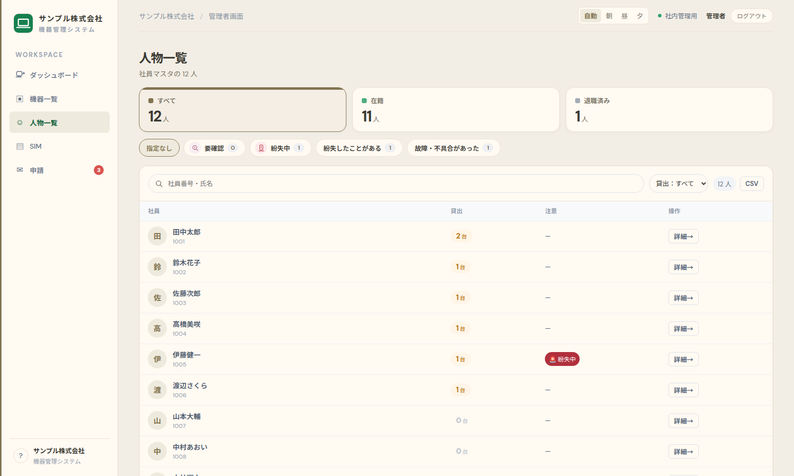
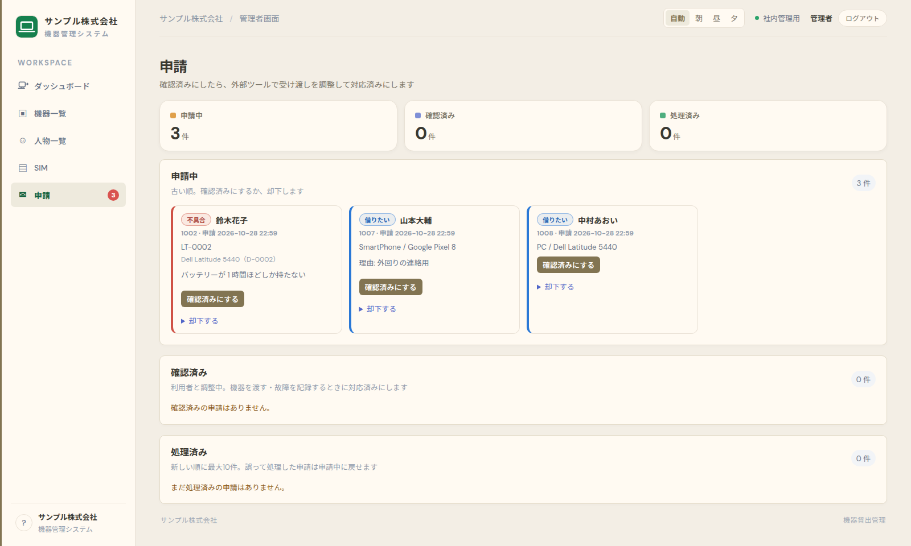
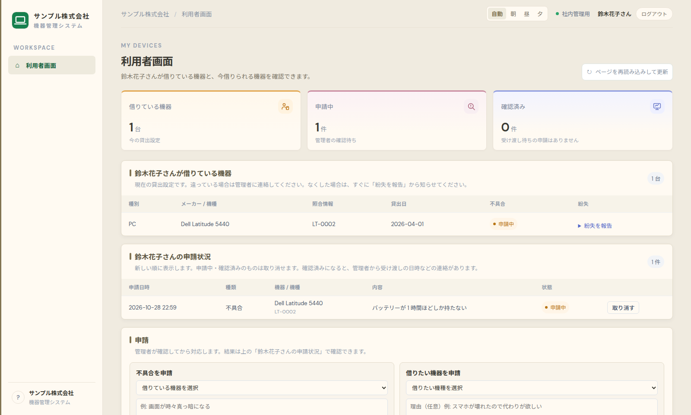
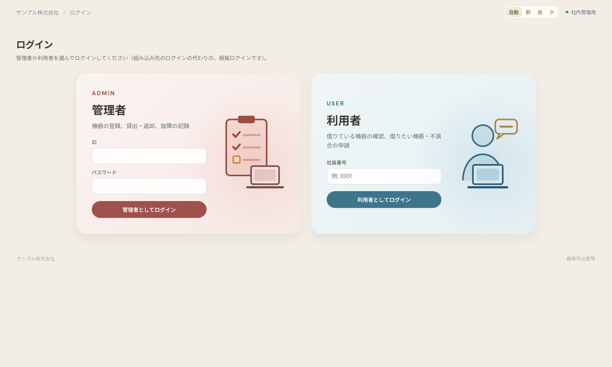
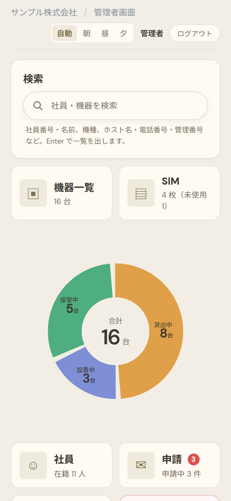
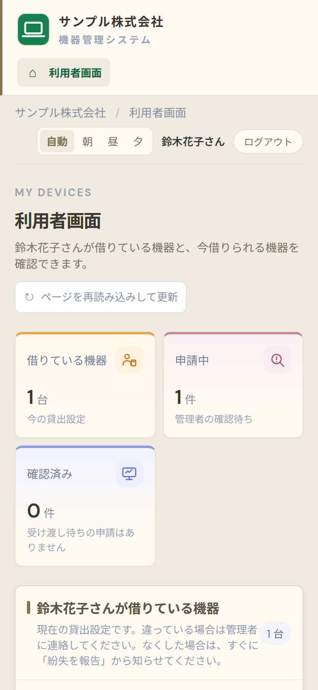

# 機器貸出管理システム

社内の PC・スマホ・モバイル Wi-Fi・電話などの貸出を、まとめて管理する Web アプリです。
インターンで、2 人 1 組で開発しました。

> 社名・社員・機器のデータはすべて架空のものに置き換えています。



## 画面

| 機器一覧 | 機器の詳細 |
|---|---|
|  |  |
| **人物一覧** | **申請（管理者）** |
|  |  |
| **利用者画面** | **ログイン** |
|  |  |

スマホにも対応しています。

<p>
  
  
</p>

## 担当範囲

管理者ページのダッシュボードのデザインはペアが担当し、それ以外（DB 設計、バックエンド、
利用者ページ、一覧・詳細ページ、ログイン、テストなど）は私が担当しました。

## 主な機能

**管理者**
- ダッシュボード: 配置（貸出中・設置中・保管中）と種別の内訳、「対応が必要なこと」、最新の変更
- 機器: 登録・貸出・返却・設置・廃棄、故障・不具合と紛失の記録、照合情報（ホスト名・内線・シリアル番号）
- SIM: 登録と、機器への差し替え
- 人物一覧: 社員ごとの貸出状況、退職者や不明な社員が借りたままの機器の検出
- 利用者からの申請の確認・対応・却下
- 管理者だけに届く通知（未確認の申請、対応が必要なこと）
- すべての変更履歴、CSV 出力、キーワード検索

**利用者**
- 自分が借りている機器の確認
- 借りたい機器・不具合の申請、紛失の報告

## 技術

- Python 3.13 / Flask 3.0 / Jinja2
- MySQL 8.4（PyMySQL）。社員・機種は別システムのマスタ（読み取り専用）を参照する前提
- HTML / CSS / JavaScript（フレームワークなし）
- pytest（343 件）、GitHub Actions、Docker Compose

設計で気をつけたこと:
- 貸出・故障・紛失は行を消さずに追記し、変更履歴（`device_events`）に残す
- 「1 台につき貸出中は 1 件まで」などのルールを、アプリだけでなく DB の制約（生成列 + UNIQUE、CHECK）でも守る
- DB の変更は `sql/migrations/` に連番で残す

## 起動方法

Docker が必要です。

```sh
docker compose up -d --build
```

http://127.0.0.1:8000 を開きます。初回の起動時に、デモ用の架空データが入ります。

| ログイン | 入力 |
|---|---|
| 管理者 | ID `admin` / パスワード `admin` |
| 利用者 | 社員番号 `1001`〜`1011` |

ログインは、組み込み先のシステムのログインの代わりになる模擬ログインです。

## テスト

```sh
docker run -d --name device-lending-test-db -e MYSQL_ROOT_PASSWORD=test \
    -p 127.0.0.1:3317:3306 mysql:8.4.7 --default-time-zone=+09:00
python -m venv .venv && .venv/bin/pip install -r requirements-dev.txt
.venv/bin/pytest
```

## フィードバック

完成後、担当の方から次のような評価をいただきました。

- デザインは、商用のサービスとしては良いが、社内システムとしては装飾が多いため不採用
- 管理者だけに届く通知は面白いので採用したい

## 学んだこと

**使いたいデザインと使いやすいデザインは別だということ。**
最初のデザインでは無駄を削ぎ落とすことに注力していました。しかし、何か堅苦しい、物足りないデザインになっていました。
そこで一度、使いやすさという視点を取り払って、ペアがやりたいことを組み込んだデザインに変更しました。
それにより、使いたいと思えるデザインに変わりました。
固定観念が、惹きつけるデザインを生み出すことを妨げていると思うと同時に、使いやすさは固定されているものなのかもしれないと思いました。

**少人数の社内システムの仕事は、裁量が大きいということ。**
その分必要な知識量は増えますが、やりがいに繋がりそうだと思いました。

**変更点をわかりやすく書いておいたほうがいいということ。**
コミットメッセージが適当だと何を変更したかわからず、変更箇所の分析から入らないといけないのが大変でした。

**何が「最適」なのかは、利用者目線で考える必要があるということ。**
このシステムは、管理者と利用者で見たいことが変わります。
余計な情報はかえって理解しづらくするため、必要な情報だけを表示させることが重要だと思いました。
